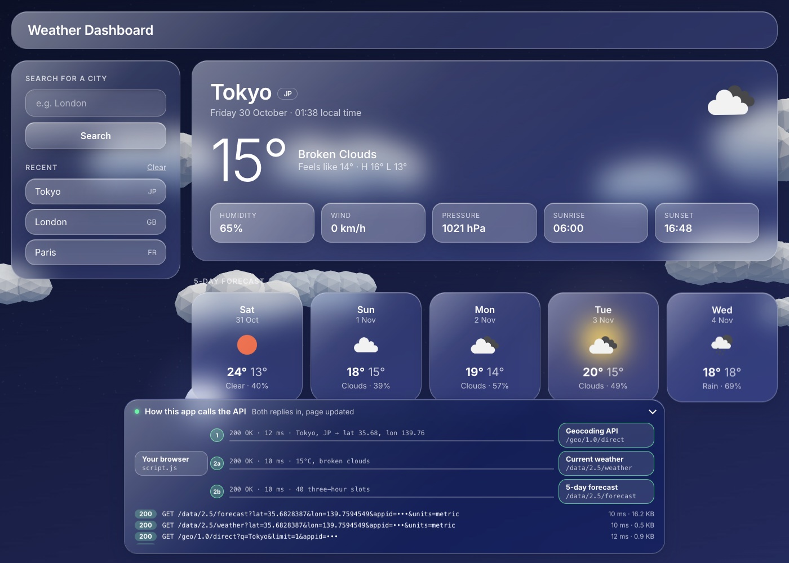

# Weather Dashboard

[](https://opensource.org/licenses/MIT)

## Description

Server APIs allow developers to access another application's data and functionality by making requests with specific parameters to a URL. This weather dashboard calls the [OpenWeather API](https://openweathermap.org/api) to show the current weather and a 5-day forecast for any city.

It has a responsive "liquid glass" interface over a live 3D weather scene. A floating panel at the bottom animates every API call the app makes, so you can watch how it talks to the server.

## Table of Contents

- [Deployed Link](#deployed-link)
- [Screenshot](#screenshot)
- [Features](#features)
- [How the App Calls the API](#how-the-app-calls-the-api)
- [Usage](#usage)
- [Running Locally](#running-locally)
- [Project Structure](#project-structure)
- [Technologies](#technologies)
- [What's New](#whats-new)
- [Tests](#tests)
- [License](#license)
- [Contributing](#contributing)
- [Questions](#questions)

## Deployed Link

https://axeljamal.github.io/s-api-js-weather-dashboard/

## Screenshot



## Features

**Weather**

- Current conditions: temperature, feels like, high and low, humidity, wind (km/h), pressure, sunrise and sunset, all in the city's local time
- 5-day forecast with each day's high and low and midday conditions
- Recent searches saved in your browser (up to 8, no duplicates), and the last city loads automatically
- Friendly error message for cities that can't be found

**3D weather scene** (Three.js)

- Low-poly 3D clouds that grow in and drift with the real wind speed
- The sun rises in the day, and a moon and stars come out at night
- Falling rain, lightning flashes in storms, drifting snow and thicker fog for mist
- The scene blends smoothly into the new weather when you change city
- The camera follows your mouse for a parallax effect

**Liquid glass UI**

- Frosted glass panels with highlights, and background colours that match the weather
- Cards flip in in 3D and tilt towards your mouse, with a moving shine
- Responsive layouts for desktop, tablet and phone

**API flow panel**

- A floating panel that animates each request and response as it happens (see below)
- A live log of recent calls with status, path, time and size
- Collapses to a small bar, and remembers whether it was open

**Accessibility**

- Respects "reduce motion" settings, turning the animations off
- Falls back to a flat animated background if WebGL isn't available

## How the App Calls the API

Every search makes up to three requests to OpenWeather:

```
                 1. GET /geo/1.0/direct?q=Tokyo&limit=1        ┌────────────────┐
              ───────────────────────────────────────────────▶ │ Geocoding API  │
              ◀─────────────── lat 35.68, lon 139.76 ───────── └────────────────┘
 ┌─────────┐
 │ Browser │  2a. GET /data/2.5/weather?lat=…&lon=…            ┌────────────────┐
 │script.js│ ────────────────────────────────────────────────▶ │ Current weather│
 └─────────┘ ◀──────────── temp, conditions, wind… ─────────── └────────────────┘
              2b. GET /data/2.5/forecast?lat=…&lon=…           ┌────────────────┐
              ───────────────────────────────────────────────▶ │ 5-day forecast │
              ◀──────────── 40 three-hour slots ────────────── └────────────────┘
```

1. **Geocoding** turns the city name into latitude and longitude.
2. **Current weather (2a)** and **forecast (2b)** are requested at the same time with `Promise.all`, using those coordinates.
3. When both replies arrive, the page is updated.

Clicking a city in **Recent** skips step 1, because its coordinates were saved from the first search. If the city isn't found, steps 2a and 2b are never made.

The floating panel at the bottom of the page shows this live. `script.js` sends its requests through an `apiFetch()` wrapper, which fires `api:request` and `api:response` events. `api-flow.js` listens for those events and animates a packet along each lane. The API key is always shown as `•••`.

Each search gets a run number. If an older search's reply arrives late, it is ignored, so it can't overwrite the city you just searched.

## Usage

1. Open the [deployed site](https://axeljamal.github.io/s-api-js-weather-dashboard/).
2. Type a city name and press **Search** (or Enter).
3. Watch the API panel at the bottom as the requests go out and the replies come back.
4. Click a city under **Recent** to load it again, or **Clear** to empty the list.

## Running Locally

The 3D scene is a JavaScript module, and browsers don't load modules from `file://`. So run the app through a local web server instead of double-clicking `index.html`:

```bash
git clone https://github.com/axeljamal/s-api-js-weather-dashboard.git
cd s-api-js-weather-dashboard
python3 -m http.server 8000
```

Then open http://localhost:8000. The VS Code **Live Server** extension also works.

## Project Structure

```
index.html              Page layout and the API flow panel markup
assets/css/style.css    Liquid glass styles, themes, 3D card effects, responsive layout
assets/js/script.js     Search, API calls, rendering, history, card tilt
assets/js/scene.js      3D weather scene (Three.js)
assets/js/api-flow.js   Animated API flow panel and call log
assets/images/          Screenshot
```

## Technologies

- HTML, CSS and JavaScript (no framework)
- [OpenWeather API](https://openweathermap.org/api): Geocoding, Current Weather and 5 Day / 3 Hour Forecast
- [Three.js](https://threejs.org/) for the 3D scene
- `Intl` date formatting, `localStorage` and `CustomEvent`
- Google Fonts (Inter)

## What's New

**2026 update**

- Rebuilt the interface with a responsive liquid glass design and removed Bootstrap and jQuery
- Added the 3D weather scene, 3D card animations and the floating API flow panel
- "Today" now uses the current weather endpoint instead of the first forecast slot
- Fixed the 5-day forecast breaking at the end of each month; days are now grouped by the city's local date
- Wind speed is shown in km/h (it was in m/s but labelled KPH)
- Unknown cities show an error instead of crashing, and aren't saved to history
- Weather icons load over HTTPS so they work on GitHub Pages
- **Clear** only removes this app's history instead of all `localStorage`
- The searched city name is shown instead of the nearest weather station's name
- Slow replies from an earlier search no longer overwrite a newer one

## Tests

Tested by hand in Chrome on desktop and phone-sized screens:

- Searching a city, a city that doesn't exist, and loading from history
- Forecast days across a month boundary and in different time zones
- Clear, cloudy, rain, storm, snow and night scenes

## License

This project is licensed under the [MIT License](./LICENSE).

## Contributing

None

## Questions

Please reach out to me at axeltaj@gmail.com if you have any questions.
Also, feel free to view this project and others at https://github.com/axeljamal
